# Deck 90 — retro hi‑fi audio analyzer for Windows and Linux

[Español](README.md) · **English**

[](https://github.com/djkollmax/deck-90/releases/latest)


[](LICENSE)

**Deck 90 is a free, open-source desktop audio analyzer with a '90s hi‑fi look.** It listens to whatever your computer is playing and shows it on needle VU meters, a spectrum analyzer, a loudness meter (LUFS, true peak, LRA), BPM, a goniometer, an oscilloscope and cassette decks whose tape actually turns. It works with Spotify, YouTube, Tidal, Apple Music or any player, **with no virtual cable and no setup**; it also shows the track that's playing and drives the player from the deck's keys. It pairs well with [Spotless](https://github.com/nix-codes/spotless).

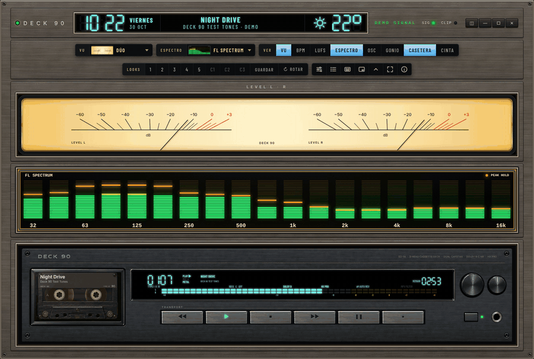

### ⬇️ [Download Deck 90 (Windows or Linux)](https://github.com/djkollmax/deck-90/releases/latest)

1. On the latest release, grab `Deck-90-…-win32-x64.zip` (Windows) or `Deck-90-…-linux-x64.zip` (Linux).
2. Unzip it anywhere. Nothing needs to be installed.
3. Run `Deck 90.exe` (or `deck-90` on Linux), play music in any player, and it starts measuring.

From then on it **updates itself**: when a new release is out it says so, and one click on **INSTALAR** brings it up to date.

---

**Clock and weather in the header:** the time in 7-segment digits with the day and date, the song in the middle, and the weather where you are, with its icon, the temperature, the sky, the city and today's high and low.

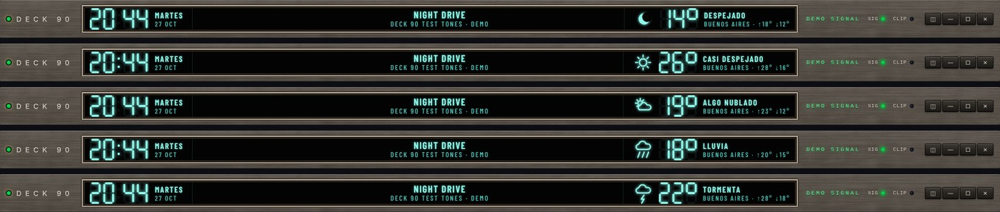

**The DECK 90 cassette deck:** the tape's reels turn as a real C90's, the song is on the label and on the display, the level meters have yellow and red zones, and the keys drive the player. One deck or two.

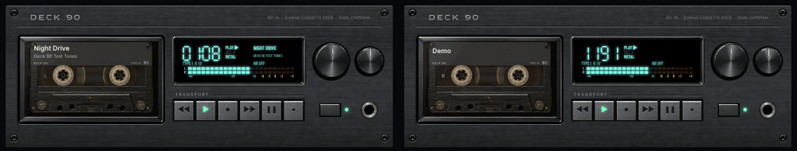

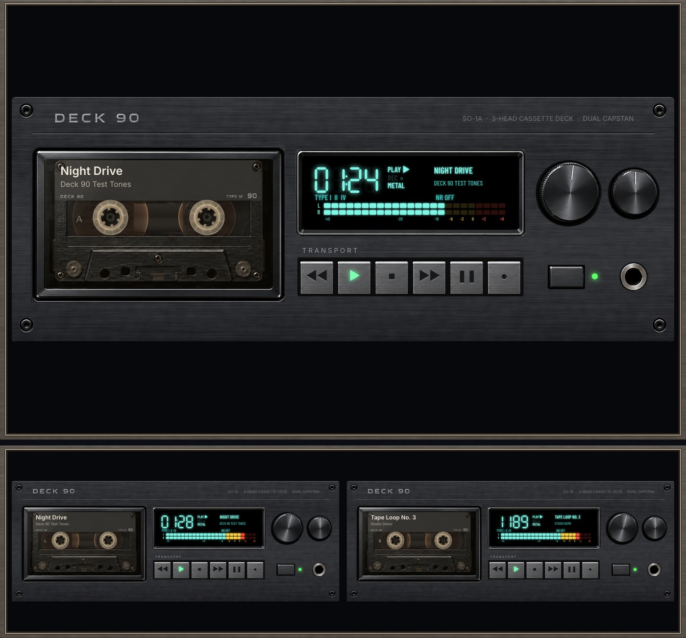

**The big tape, SO-90 REEL:** gold open reels over the tape packs that change as the side plays. Or the **CD-90**: a steel CD panel and an FL display with the time, the track, the song, its progress and a live spectrum. In a wide window the CD-90's panel grows sideways too.

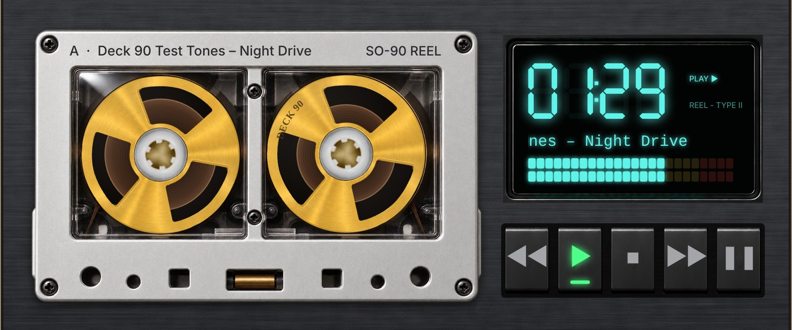

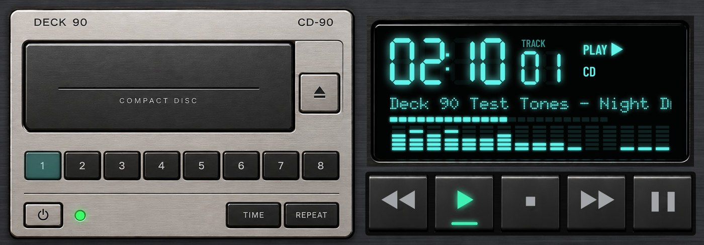

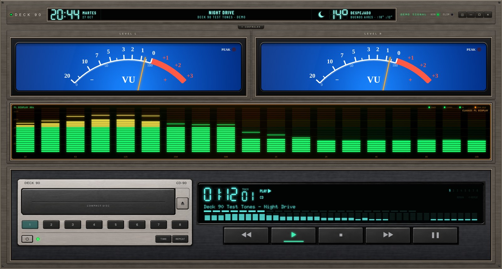

**Seven VU faces:** STUDIO, HI-FI 90s, CINTA 70s, AZUL, AZUL INTENSO and CREMA, and DÚO, both meters side by side on one wide cream face scaled −60 to +3 dB, like a cassette deck's level meter.

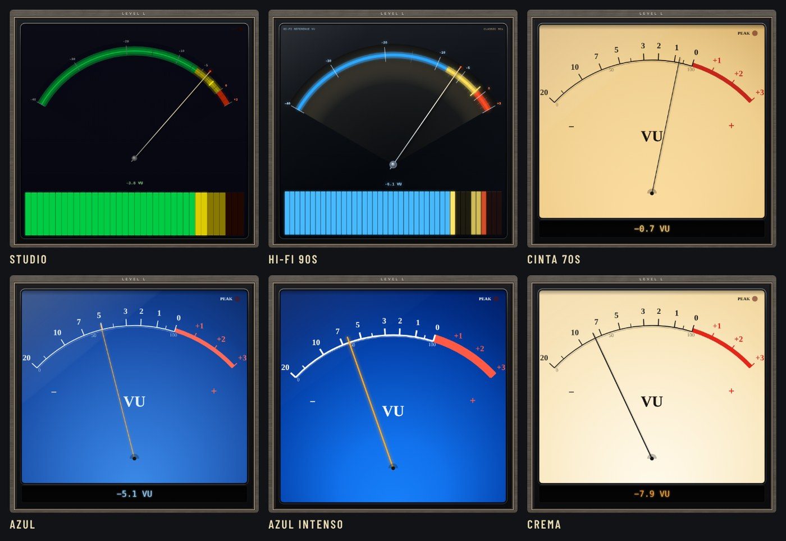

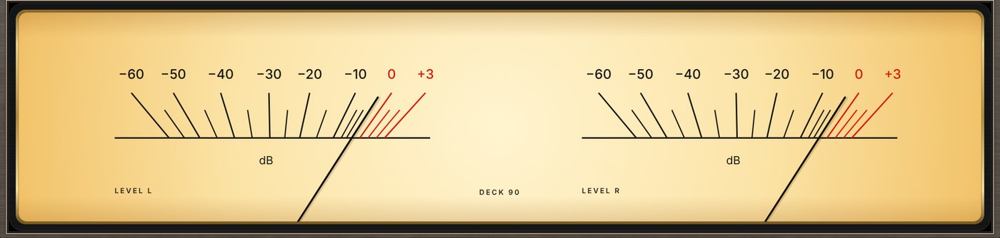

**Twelve spectrum styles,** from a mini system's fluorescent display to a studio's third-octave analyzer; the newest, FL SPECTRUM and FL SPECTRUM CIAN, are the classic green turning yellow and orange at the top, or turquoise with each bar's tip paler, both with orange peaks and a PEAK HOLD lamp.

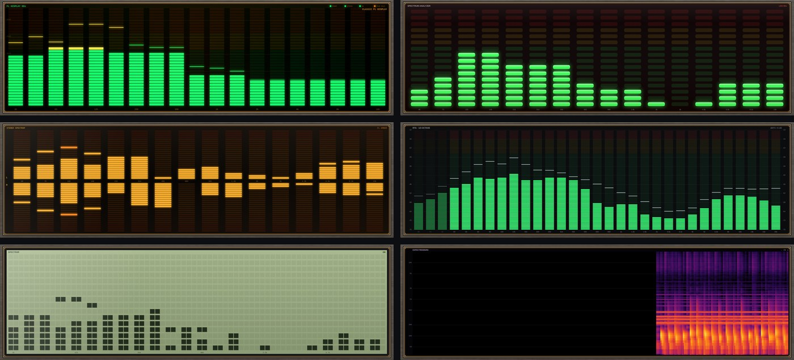

**Five ready-made looks and three of your own** (`F1`–`F8`): Estudio, Hi-Fi 90s, Cinta 70s, Vidriera and Mastering.

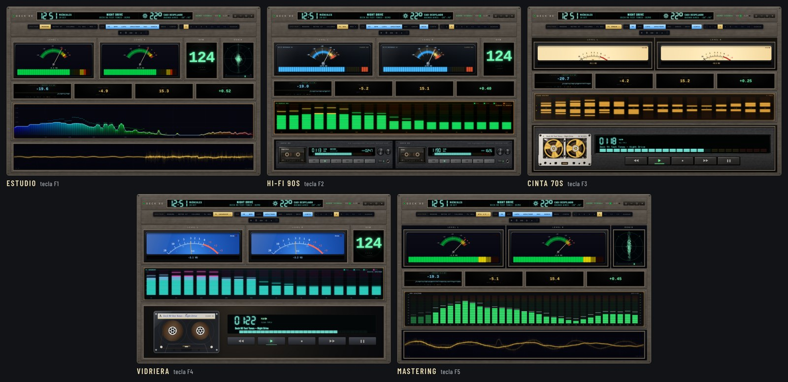

**Three metal frames:** TITANIO, NEGRO and CHAMPAGNE (or the CLÁSICO dark rack). Every display sits behind glass in a polished bevel, its name engraved above it.

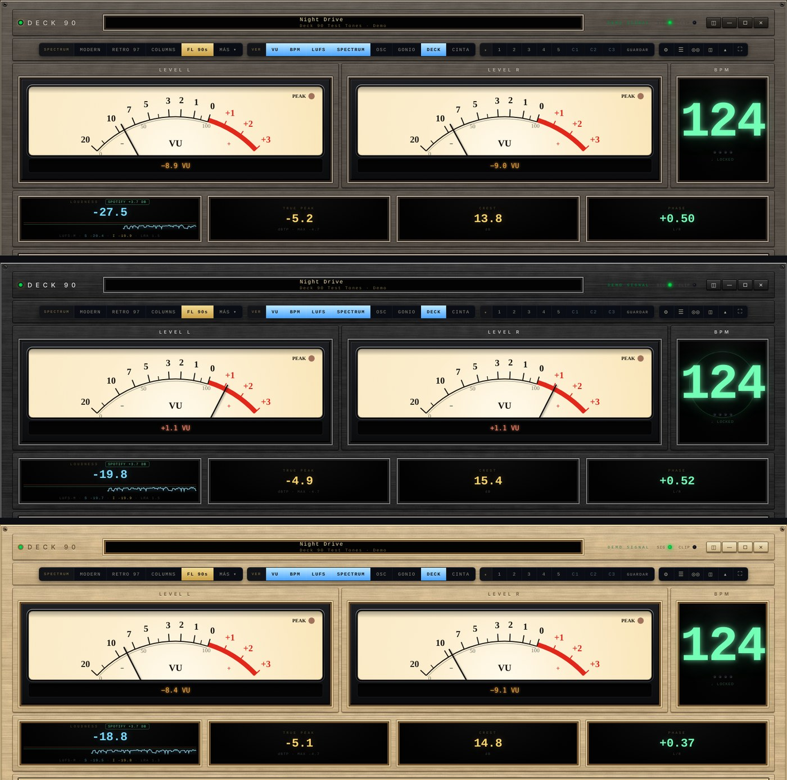

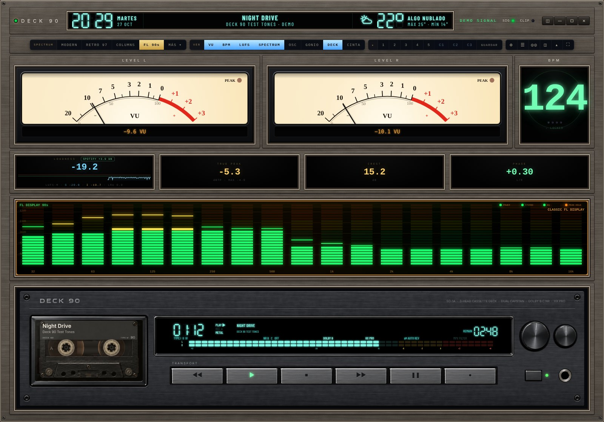

**One console** for everything; ⚙ opens the drawer with the finer settings.

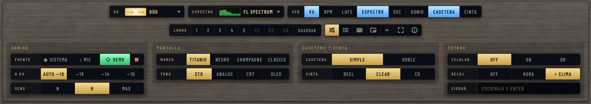

**Phone display:** everything, the VU meters, FL 90s, the spectrogram and the cassette, live from the PC.

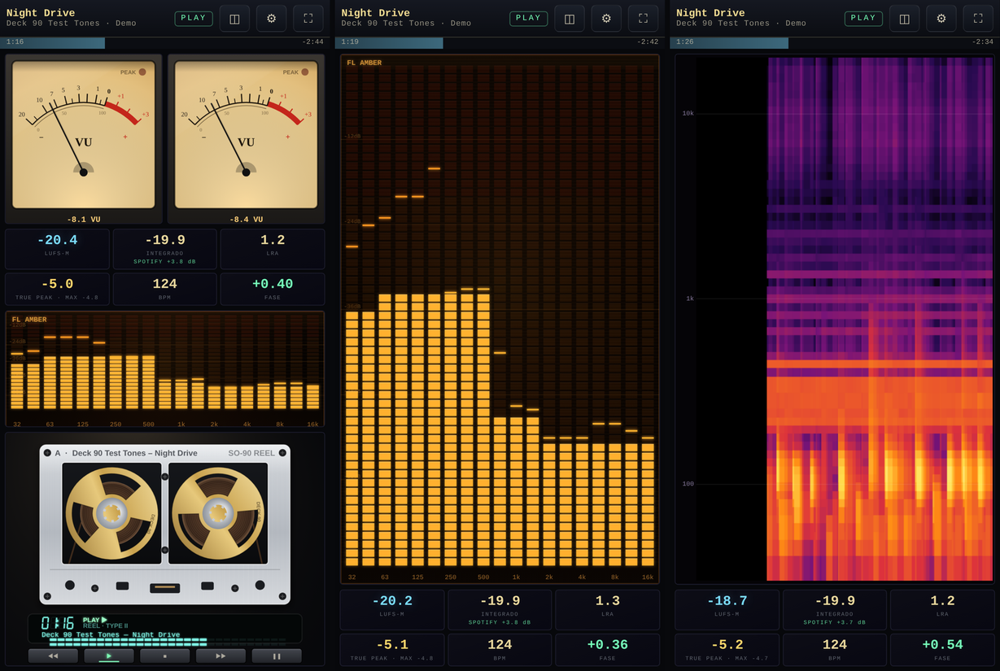

**Track history** with the Spotify change for each track, exported to Excel.

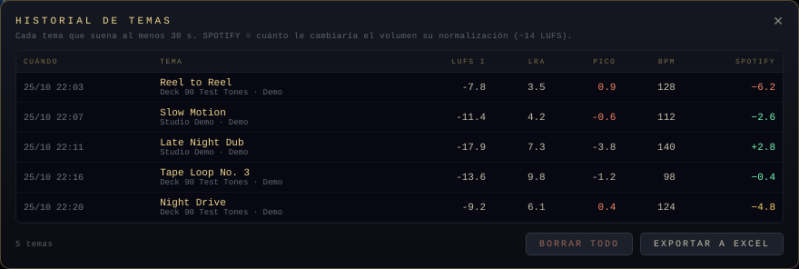

| | |
|---|---|
| 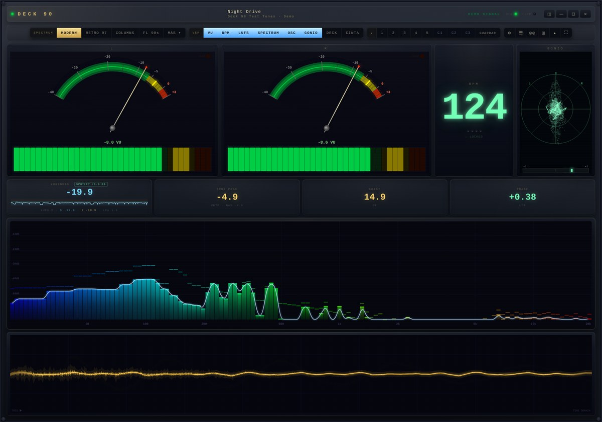 | 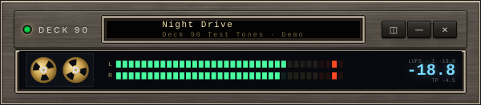 |

*Screenshots use the built-in DEMO signal; track names are made up.*

## Features

- **System audio with no setup.** On Windows it uses WASAPI loopback, so there's no virtual cable (VB-Cable, Voicemeeter) and no picker dialog. On Linux it uses the PulseAudio/PipeWire *Monitor* source. Microphone input is also available.
- **VU meters.** Each needle has spring-damper ballistics. Six faces: STUDIO and HI-FI 90s (with an LED bar), CINTA 70s (warm backlit cream face, black needle), AZUL and AZUL INTENSO (blue backlit faces, amber needle) and CREMA; the last four use the classic −20…+3 VU scale spaced like the real instrument. The reference level can be AUTO, −18, −14 or −10 dBFS.
- **Loudness.**
  - Momentary, short-term and integrated LUFS (ITU-R BS.1770 / EBU R128 K-weighting and gating).
  - Integrated LUFS and loudness range (LRA, EBU Tech 3342) restart on every new track.
  - True peak in dBTP (BS.1770-4, 4x oversampling) with the track's maximum, plus crest factor and phase correlation.
  - **Spotify badge:** how much Spotify's loudness normalisation would change the track's volume (everything is played at −14 LUFS; a quieter track is raised only until its peak reaches −1 dB). With Spotless it allows for Spotless's own volume.
- **Track history.** Every track heard for at least 30 s is logged with its integrated LUFS (as heard and the master's, without Spotless's volume), LRA, peak, BPM and the Spotify change. Open it with `L` or ☰ and export it as a CSV that Excel opens (`;` between fields, decimal commas).
- **BPM.** Onset detection runs in an AudioWorklet. Tempo is found by autocorrelation over the last 8 s.
- **Spectrum** in twelve styles (`T` steps through them, MÁS ▾ lists the newer ones):
  - MODERN: smooth curve with peaks.
  - RETRO 97: LED columns.
  - COLUMNS: classic bars.
  - FL 90s: wide segmented fluorescent bars.
  - FL SHOWROOM: the turquoise shop-window display; after a few seconds of silence it plays its demo patterns.
  - FL SPECTRUM: a clean black window in a gold line, green bars turning yellow and orange at the top, orange peak caps and a PEAK HOLD lamp. FL SPECTRUM CIAN is the same window in turquoise, each bar's top segments paler whatever its height.
  - FL ÁMBAR: stereo, the left channel rising from the middle and the right one hanging down, in warm amber.
  - LED 80s: columns of rectangular LEDs, green, yellow and red, with a falling peak LED.
  - RTA 1/3: 31 ISO third-octave bands with the power of each band, like a studio real-time analyzer.
  - LCD: a green dot-matrix panel.
  - ESPECTROGRAMA: the track as a waterfall, time to the left, frequency upwards, colour for level.
  - The hardware-style ones (FL, LED, LCD, RTA) follow the SENS setting (`K`).
- **Oscilloscope.**
- **Goniometer.** The stereo image as a cloud of dots: mono stands upright, wide stereo spreads out, out-of-phase content lies down. A correlation bar sits underneath.
- **Cassette decks.** One DECK 90 or two, and a big tape: SO-90 REEL, CLEAR or the CD-90 player. The tape runs only while music is actually playing.
- **Now playing.**
  - Shows the title, artist and cover from the system's media session: Spotless, Spotify, a browser tab (YouTube, SoundCloud…), Apple Music or any player that reports to Windows. The one that's playing wins (Spotless first if several play). Browser tab titles are cleaned up into the song and the artist.
  - The deck keys control the player: play/pause, stop, next and previous.
- **Modules.** Every module can be switched off, and the rest grow to fill the space.
- **Presets: five favourites and three of your own.** Each keeps a whole look: VU face, spectrum style and sensitivity, screen tone, VU calibration, the modules shown, and the deck and cassette styles. 1–5 (F1–F5) are fixed: Estudio, Hi-Fi 90s, Cinta 70s, Vidriera and Mastering. C1–C3 (F6–F8) are yours: GUARDAR then C1–C3 (or Shift+click, Shift+F6–F8) stores what's on screen there. The one matching the screen lights up.
- **Clock and weather in the header.** With the metal frames, the display at the top spans the header: the time in the decks' 7-segment digits with the day and date on its left, the song in the middle, and on its right the weather where you are: an FL icon, the temperature, the sky, the city and today's high and low. Type your city in the ⚙ drawer (RELOJ). The weather comes from [Open-Meteo](https://open-meteo.com) every 15 minutes: only the city's name (once, to find it) and its coordinates are sent there. RELOJ also turns it into just the clock, or off.
- **The frame of a premium '90s deck.** MARCO in the ⚙ drawer: brushed TITANIO, NEGRO or CHAMPAGNE plates with every display behind glass in a polished bevel and its name engraved above it, or the CLÁSICO dark rack.
- **Light on the machine.** What doesn't move in a display is painted once and copied each frame; minimized or in the tray nothing is drawn (measuring goes on); at most 60 frames a second; and with a song paused, once everything has settled, nothing is drawn until something moves again.
- **It remembers.** The look, the window's size and place (or maximized), the mini strip's place, the phone display and the tray choices all come back as you left them.
- **Tray.** Deck 90 sits by the clock: on Windows ✕ leaves it measuring there (the phone display keeps working; Shift+✕ quits), and its menu shows the window, switches mini mode and the phone display, starts it with Windows (hidden, straight to the tray) and quits.
- **Phone display.** Turn on *CELULAR* in the settings drawer and scan the QR code: a phone or tablet on the same network shows the VU meters, the spectrum, the spectrogram, the big cassette, the track and the loudness numbers live, in portrait or landscape, and its cassette keys control the player. It's off until you turn it on, and the address carries a key so nobody else on the network can drive it (*Nueva clave para el celular* in the tray menu changes it, cutting off every phone that scanned the old one).
- **Mini mode.** A small strip that stays on top of other windows: reels, L/R bars, loudness and true peak, with the track in the title bar. It remembers its size and place.
- **Frameless window.** All controls sit in one console. Display modes: STD, ANALOG, CRT and OLED.
- **Updates itself.** It asks GitHub at start, every hour and when it comes back from the tray (or from the tray menu: *Buscar actualizaciones*). When a newer release is out, the program offers it; INSTALAR downloads a small package with the program's own files, checks its SHA-256 against the one GitHub publishes, keeps the previous version in `resources\app-anterior` and restarts. If the new version doesn't start (or its window hasn't loaded after 2 minutes), Deck 90 puts the previous one back by itself and doesn't offer that version again. A release that changes Electron itself asks you to download the full zip instead.

## Download & run

Grab the zip for your system from **[Releases](https://github.com/djkollmax/deck-90/releases/latest)**, unzip it anywhere and run the program:

- **Windows 10/11 (x64):** `Deck 90.exe`
- **Linux (x64):** `deck-90`

Nothing needs to be installed on Windows. If Windows SmartScreen says "Windows protected your PC" (it does for new programs without a paid signing certificate), click **More info → Run anyway**; every release is built on GitHub's servers from the code here.

Settings, the track history (`history.json`) and the log (`media.log`) are kept in your user folder:

- Windows: `%APPDATA%\Deck 90`
- Linux: `~/.config/Deck 90`

## Platform support

| | Windows 10/11 | Linux |
|---|---|---|
| System audio | WASAPI loopback ✅ | PulseAudio / PipeWire monitor source (implemented, field-testing welcome) |
| Now playing + transport keys | System Media Transport Controls ✅ | MPRIS over D-Bus via `gdbus` ✅ |
| Window, modules, all displays | ✅ | ✅ |

On Linux the app needs a *Monitor* source (PulseAudio and PipeWire create one per output); without it, use the microphone input. `gdbus` ships with GLib and is present on practically every desktop.

If the Linux build closes right away with a message about the *SUID sandbox helper* (Ubuntu 23.10+ and others that restrict user namespaces), give Electron's sandbox helper the permissions it expects, once:

```sh
cd "Deck 90-linux-x64"
sudo chown root:root chrome-sandbox && sudo chmod 4755 chrome-sandbox
```

`src/index.html` also opens in a browser, but browsers capture system audio poorly: on Chrome for Windows you must tick "share system audio", and Linux browsers can't capture it at all. The microphone input and DEMO work everywhere.

## Phone display

1. In Deck 90 open the settings drawer (⚙) and press **CELULAR → ON**. A QR code appears.
2. Scan it with the phone's camera. The phone must be on the same Wi-Fi as the PC.
3. Swipe sideways (or tap ◫) to switch views: everything, VU meters, FL 90s spectrum, spectrogram, cassette. Tap ⛶ for full screen.
4. ⚙ holds the phone's own settings:
   - VU face, cassette and FL sensitivity: follow the PC or pick your own.
   - Whether the FL 90s shows in the "everything" view.
   - A dim night mode.
   - A short vibration on the cassette keys.

A bar under the title shows the track's progress, with the time played and the time left.

The first time, Windows asks whether Deck 90 may use the network: allow it on **private** networks. If the phone can't connect, check that the PC's network is set to *Private*. Port 9090 is used. Browsers keep phones awake only on secure pages, so for a permanent display set the phone's screen timeout, or use Android's *Stay awake while charging*.

## Keys

| Key | Action |
|---|---|
| `S` / `M` / `D` | System audio / microphone / demo |
| `Space` / `Esc` | Stop analysis |
| `1`–`8` | Toggle modules (VU, BPM, LUFS, spectrum, oscilloscope, deck, cassette, goniometer) |
| `P` | Mini mode (always on top) / back |
| `T` | Spectrum style (twelve) |
| `K` | FL sensitivity |
| `V` | VU face (seven) |
| `C` | VU calibration |
| `N` | Display mode (STD / ANALOG / CRT / OLED) |
| `Z` | Cassette only |
| `A` | Settings drawer |
| `L` | Track history |
| `F1`–`F5` | Favourite looks 1–5 |
| `F6`–`F8` | Your looks C1–C3 (`Shift` + `F6`–`F8` saves the current look there) |
| `H` | Hide the console |
| `F` | Fullscreen |

The deck keys (◀◀ ▶ ■ ▶▶ ❚❚) control the player that is playing.

## About the numbers

The meters were checked against generated test signals:

- Peak, VU and crest are exact (crest is each channel's peak against its own RMS over 400 ms).
- LUFS (momentary, short-term, integrated) follows ITU-R BS.1770: the K-weighting filters are designed for the sound card's rate and are the recommendation's own at 48 kHz. Tones read within 0.05 dB (997 Hz at −20 dBFS reads −20.0; 2 kHz −17.6; one channel alone −23.0).
- True peak finds the peaks between samples: a 12 kHz tone at −6 dBFS sampled at 45° shows a sample peak of −9.0 and reads −6.0 dBTP. Near 20 kHz it can read about 0.2 dB high, within what BS.1770's filter allows.
- LRA reads 10.0 and 5.0 LU on EBU Tech 3342's first two test cases.
- Phase correlation is computed sample-aligned on the audio thread: mono reads +1.00, inverted −1.00.
- BPM: steady beats at 97, 124 and 140 read exactly. Fast tracks (above ~160) may read at half tempo, as with most beat trackers.
- What you measure is what the player sends to the system mix, so the player's own volume slider changes the readings. With **Spotless** the program reads its volume and levelling from Spotless's settings and takes the volume back out: the Spotify badge and the history's MASTER column are the master's own figures at any volume (Spotless's knob is a cubic curve over 60 dB: 71 % is −7.9 dB, 90 % −2.5 dB). With its *Volume levelling* on, Spotless already normalises the sound, and with its equaliser on (and not flat) it changes the sound by frequency, so in both cases the badge shows **SPOTIFY ?** until they're off. With other players, play at 100 % with their levelling off.

## Build from source

Requires Node.js 18+.

```sh
npm install
npm start                  # run in development (the first run downloads Electron)
npm run package:win        # → dist/Deck-90-<version>-win32-x64.zip
npm run package:linux      # → dist/Deck-90-<version>-linux-x64.zip
node scripts/package.mjs bundle   # → dist/Deck-90-<version>-app.bundle (the update package)
```

The packager downloads the official Electron release, checks it against Electron's published SHA-256 sums and puts the app inside it. Packaging uses `unzip`/`zip` on Linux and the built-in `tar` on Windows.

### Checks

`node scripts/check.mjs` compiles every script. On GitHub, every push also runs on a Windows machine: `scripts/test-media.ps1` checks the now-playing bridge (it parses, picks the right player among made-up sessions, starts, reports and quits), the built program is started once, and `scripts/test-update.mjs` runs the updater through a normal install, a new version that doesn't start, a damaged package and one that needs a new engine. A release is published only when all of it passes.

### Layout

```
electron/   main process: window, loopback capture, now-playing bridges (media.ps1 for Windows, mpris.js for Linux)
src/        the UI: index.html, styles.css, js/ (audio graph, meters, drawing, decks, controls)
assets/     icon
scripts/    packaging and checks
```

## Ideas or problems?

Open an [issue](https://github.com/djkollmax/deck-90/issues). If you like the project, a ⭐ helps other people find it.

## Credits

- Made by **Damián Koll** and **[Claude](https://claude.ai)** (Anthropic).
  - Damián came up with the idea and the look, tested every version on real music and decided what stayed.
  - Claude wrote the code: the audio engine, the meters and their calibration, the drawing, the cassette decks, the Windows/Linux now-playing bridges and the packaging.
- Built for and alongside [Spotless](https://github.com/nix-codes/spotless) by Nico (nix-codes).
- Runs on [Electron](https://www.electronjs.org/) (MIT). Release builds include Electron's and Chromium's license files (`LICENSE`, `LICENSES.chromium.html`).
- Weather data by [Open-Meteo.com](https://open-meteo.com) ([CC BY 4.0](https://creativecommons.org/licenses/by/4.0/)).
- Display lettering: [Barlow Condensed](https://github.com/jpt/barlow) by Jeremy Tribby and [Doto](https://github.com/oliverlalan/Doto) by Óliver Lalan, both under the [SIL Open Font License 1.1](https://openfontlicense.org/) (licence texts in `src/fonts/`). Bundled as Latin subsets.

All product names in this project are generic. Deck 90 is not affiliated with any hardware or software maker.

## License

[MIT](LICENSE) · [What's new in each version](CHANGELOG.md)
