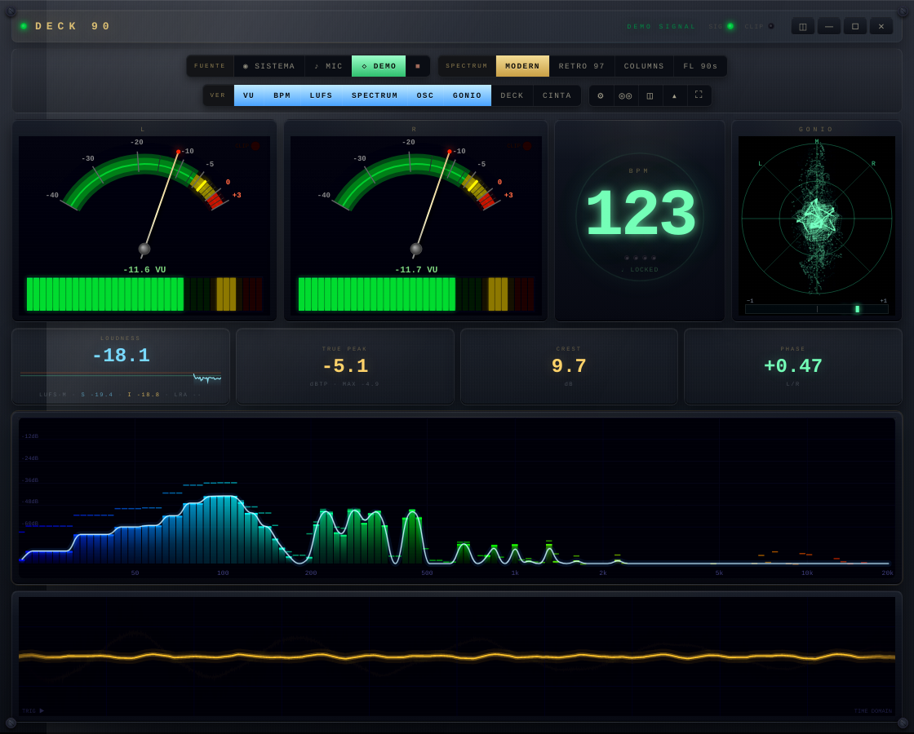
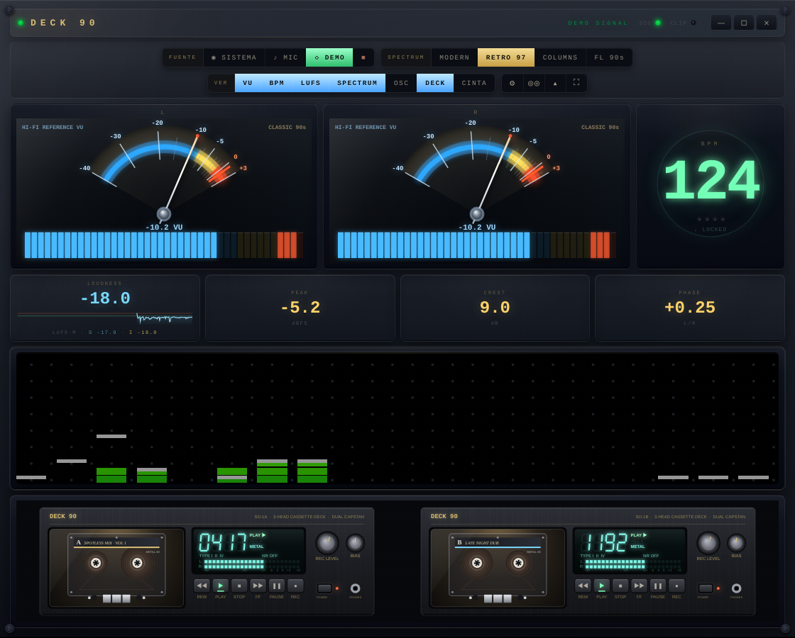
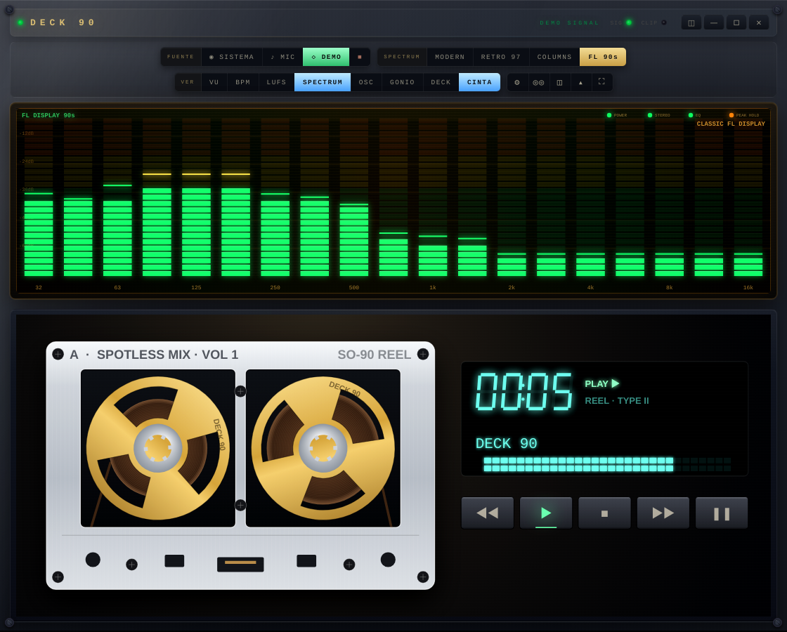
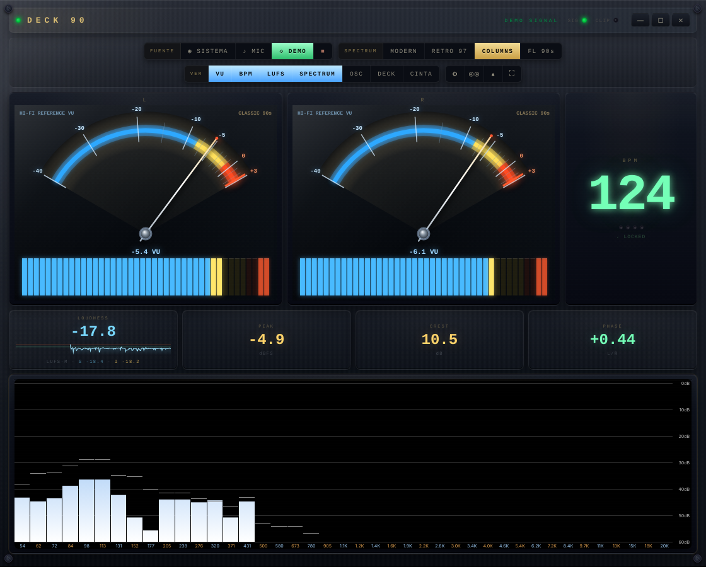

# Deck 90

A desktop audio analyzer with a retro hi-fi look. It listens to whatever your computer is playing and shows it on VU meters, a spectrum analyzer, loudness meters, an oscilloscope and a pair of cassette decks whose tape actually turns. It also shows the track that's playing now, and pairs well with [Spotless](https://github.com/nix-codes/spotless).



| | |
|---|---|
|  |  |
|  | |

*Screenshots use the built-in DEMO signal.*

## Features

- **System audio with no setup.** On Windows it uses WASAPI loopback, so there's no virtual cable and no picker dialog. On Linux it uses the PulseAudio/PipeWire *Monitor* source. Microphone input is also available.
- **VU meters.** Each needle has spring-damper ballistics. Choose a STUDIO or HI-FI 90s face. The reference level can be AUTO, −18, −14 or −10 dBFS.
- **Loudness.**
  - Momentary, short-term and integrated LUFS (ITU-R BS.1770 / EBU R128 K-weighting and gating).
  - Integrated LUFS restarts on every new track.
  - Also shows sample peak with hold, crest factor and phase correlation.
- **BPM.** Onset detection runs in an AudioWorklet. Tempo is found by autocorrelation over the last 8 s.
- **Spectrum** in four styles:
  - MODERN: smooth curve with peaks.
  - RETRO 97: LED columns.
  - COLUMNS: classic bars.
  - FL 90s: wide segmented bars, with three sensitivity levels.
- **Oscilloscope.**
- **Cassette decks.** Choose one deck or two. A big CINTA cassette comes as REEL (aluminium open-reel look) or CLEAR. The tape runs only while music is actually playing.
- **Now playing.**
  - Shows the title, artist and cover from the system's media session. Spotless is preferred when several players are open.
  - The deck keys control the player: play/pause, stop, next and previous.
- **Modules.** Every module can be switched off, and the rest grow to fill the space.
- **Frameless window.** All controls sit in one console. Display modes: STD, ANALOG, CRT and OLED. Your settings are remembered.

## Download & run

Grab the zip for your system from **Releases**, unzip it anywhere and run the program:

- **Windows 10/11 (x64):** `Deck 90.exe`
- **Linux (x64):** `deck-90`

Nothing needs to be installed on Windows. Settings and the log (`media.log`) are kept in your user folder:

- Windows: `%APPDATA%\Deck 90`
- Linux: `~/.config/Deck 90`

## Platform support

| | Windows 10/11 | Linux |
|---|---|---|
| System audio | WASAPI loopback ✅ | PulseAudio / PipeWire monitor source (implemented, field-testing welcome) |
| Now playing + transport keys | System Media Transport Controls ✅ | MPRIS over D-Bus via `gdbus` ✅ |
| Window, modules, all displays | ✅ | ✅ |

On Linux the app needs a *Monitor* source (PulseAudio and PipeWire create one per output); without it, use the microphone input. `gdbus` ships with GLib and is present on practically every desktop.

If the Linux build closes right away with a message about the *SUID sandbox helper* (Ubuntu 23.10+ and others that restrict user namespaces), give Electron's sandbox helper the permissions it expects, once:

```sh
cd "Deck 90-linux-x64"
sudo chown root:root chrome-sandbox && sudo chmod 4755 chrome-sandbox
```

`src/index.html` also opens in a browser, but browsers capture system audio poorly: on Chrome for Windows you must tick "share system audio", and Linux browsers can't capture it at all. The microphone input and DEMO work everywhere.

## Keys

| Key | Action |
|---|---|
| `S` / `M` / `D` | System audio / microphone / demo |
| `Space` / `Esc` | Stop analysis |
| `1`–`7` | Toggle modules (VU, BPM, LUFS, spectrum, oscilloscope, deck, cassette) |
| `T` | Spectrum style |
| `K` | FL sensitivity |
| `V` | VU face |
| `C` | VU calibration |
| `N` | Display mode (STD / ANALOG / CRT / OLED) |
| `Z` | Cassette only |
| `A` | Settings drawer |
| `H` | Hide the console |
| `F` | Fullscreen |

The deck keys (◀◀ ▶ ■ ▶▶ ❚❚) control the player that is playing.

## About the numbers

The meters were checked against generated test signals:

- Peak, VU and crest are exact.
- LUFS (momentary, short-term, integrated) is within ±0.3 dB of ITU-R BS.1770 from 30 Hz to 5 kHz, K-weighting included.
- Phase correlation is computed sample-aligned on the audio thread: mono reads +1.00, inverted −1.00.
- BPM: steady beats at 97, 124 and 140 read exactly. Fast tracks (above ~160) may read at half tempo, as with most beat trackers.
- What you measure is what the player sends to the system mix, so the player's own volume slider changes the readings.

## Build from source

Requires Node.js 18+.

```sh
npm install
npm start                  # run in development
npm run package:win        # → dist/Deck-90-<version>-win32-x64.zip
npm run package:linux      # → dist/Deck-90-<version>-linux-x64.zip
```

The packager downloads the official Electron release, checks it against Electron's published SHA-256 sums and puts the app inside it. Packaging uses `unzip`/`zip` on Linux and the built-in `tar` on Windows.

### Layout

```
electron/   main process: window, loopback capture, now-playing bridges (media.ps1 for Windows, mpris.js for Linux)
src/        the UI: index.html, styles.css, js/ (audio graph, meters, drawing, decks, controls)
assets/     icon
scripts/    packaging
```

## Credits

- Made by **Damián Koll** and **[Claude](https://claude.ai)** (Anthropic).
  - Damián came up with the idea and the look, tested every version on real music and decided what stayed.
  - Claude wrote the code: the audio engine, the meters and their calibration, the drawing, the cassette decks, the Windows/Linux now-playing bridges and the packaging.
- Built for and alongside [Spotless](https://github.com/nix-codes/spotless) by Nico (nix-codes).
- Runs on [Electron](https://www.electronjs.org/) (MIT). Release builds include Electron's and Chromium's license files (`LICENSE`, `LICENSES.chromium.html`).

All product names in this project are generic. Deck 90 is not affiliated with any hardware or software maker.

## License

[MIT](LICENSE)

---

### En español

Deck 90 es un analizador de audio de escritorio con estética hi-fi retro. Escucha lo que suena en la compu y lo muestra en:

- VUmetros.
- Espectro en cuatro estilos.
- Medidores de sonoridad (LUFS), BPM y osciloscopio.
- Caseteras cuya cinta gira mientras hay música.

También muestra el tema que está sonando y controla el reproductor (ideal con Spotless).

Hecho por Damián Koll junto con Claude (Anthropic), que escribió el código.

Para usarlo, bajá el zip de **Releases**, descomprimilo y abrí el programa.

- **Windows:** el audio del sistema funciona sin configurar nada.
- **Linux:** usa la fuente *Monitor* de PulseAudio/PipeWire. El "tema actual" se lee por MPRIS.
