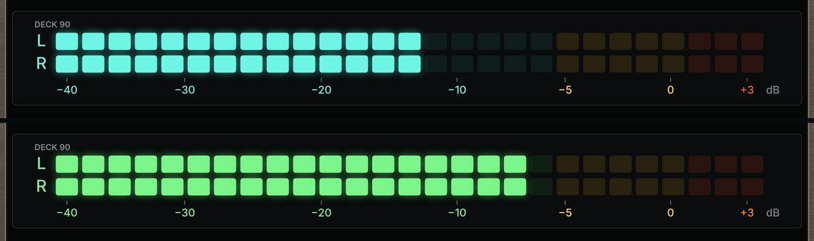
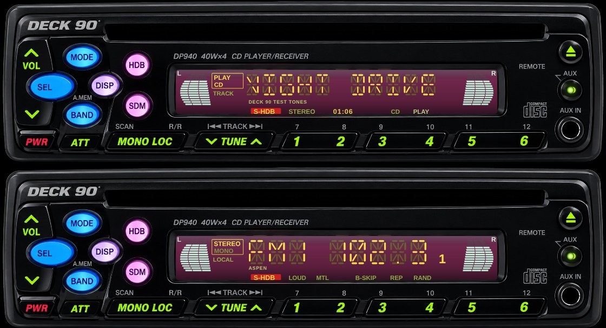
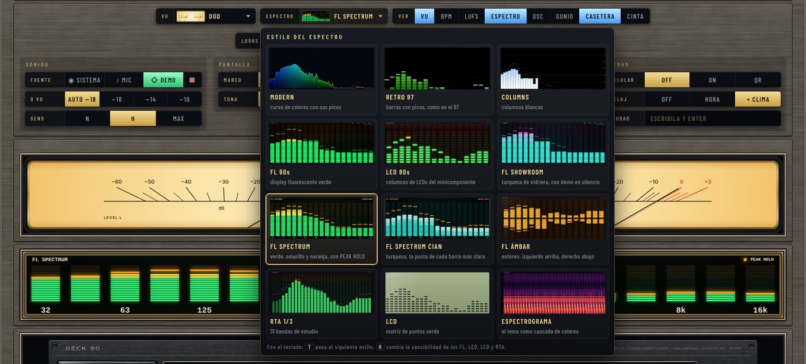
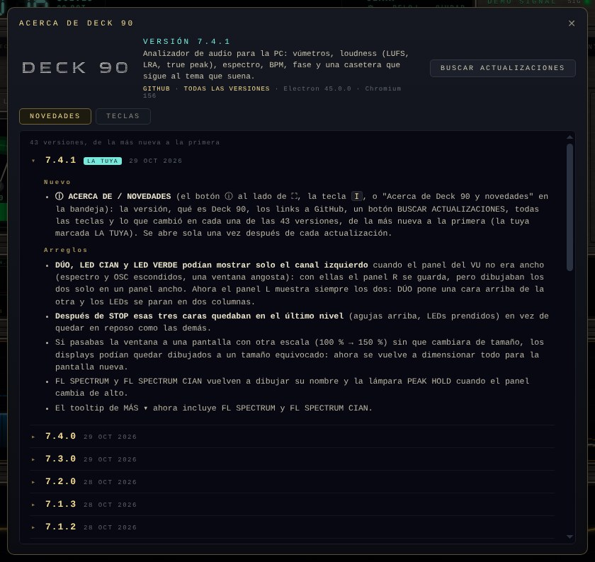

# Deck 90 — analizador de audio retro hi‑fi para Windows y Linux

**Español** · [English](README.en.md)

[](https://github.com/djkollmax/deck-90/releases/latest)


[](LICENSE)

**Deck 90 es un programa gratis y de código abierto que muestra lo que suena en tu computadora como un equipo de audio de los 90:** vúmetros de aguja, analizador de espectro, medidor de loudness (LUFS, true peak, LRA), BPM, goniómetro, osciloscopio y caseteras cuyas cintas giran de verdad. Funciona con Spotify, YouTube, Tidal, Apple Music o cualquier reproductor, **sin cables virtuales ni configuración**, y además muestra el tema que está sonando y maneja el reproductor desde las teclas de la casetera.


### ⬇️ [Descargar Deck 90 (Windows o Linux)](https://github.com/djkollmax/deck-90/releases/latest)

1. **Windows:** en la página de la última versión bajá `Deck-90-…-setup.exe` y abrilo. Se instala para tu usuario (no pide permisos de administrador), con su acceso en el menú Inicio y para desinstalarlo desde Configuración → Aplicaciones. Si preferís sin instalar, está el `Deck-90-…-win32-x64.zip`: descomprimilo donde quieras y abrí `Deck 90.exe`.
2. **Linux:** bajá `Deck-90-…-linux-x64.zip`, descomprimilo y abrí `deck-90`.
3. Poné música en cualquier reproductor y listo: se pone a medir solo. La primera vez, una bienvenida de tres pasos te muestra lo principal.

A partir de ahí **se actualiza solo**: cuando sale una versión nueva aparece un aviso y con un clic en **INSTALAR** queda al día.

---

## ¿Para qué sirve?

- **Para disfrutar la música mirándola.** Agujas que se mueven con la física de un vúmetro de verdad, displays fluorescentes como los de los equipos japoneses de los 90 y cintas que giran mientras suena el tema.
- **Para saber cómo está mezclado y masterizado un tema.** Loudness integrado (LUFS) según la norma ITU‑R BS.1770 / EBU R128, picos verdaderos (dBTP), rango dinámico (LRA), factor de cresta y correlación de fase. Ideal para productores y estudios caseros que quieren comparar su master con lo que suena en las plataformas.
- **Para ver cuánto le cambia Spotify el volumen a cada tema.** Spotify reproduce todo a −14 LUFS; Deck 90 te dice cuánto sube o baja cada canción, y lo guarda en un historial que se exporta a Excel.
- **Para tener el BPM a mano.** Detecta el tempo en vivo, útil para DJs y para entrenar.
- **Para decorar el escritorio.** Con el reloj, la fecha y el clima arriba, se convierte en el centro de un setup de escritorio o de un segundo monitor.

---

## Cómo se ve

### El display de arriba: reloj, tema y clima

La hora en dígitos de 7 segmentos con el día y la fecha, el tema que suena en el medio y el clima de tu ciudad con su ícono, la temperatura, el cielo y la máxima y mínima del día. Se configura en ⚙ → PANTALLA → RELOJ: + CLIMA, y al lado escribís tu ciudad.


### Las caseteras DECK 90

Una o dos caseteras negras de aluminio cepillado. La cinta gira como un casete C90 de verdad (los rollos cambian de tamaño a medida que avanza el lado), el tema aparece en la etiqueta y en el display fluorescente, los medidores tienen zona amarilla y roja, y las teclas manejan el reproductor: play, pausa, stop, siguiente y anterior.


### La cinta grande: SO‑90 REEL o CD‑90

El **SO‑90 REEL** es un casete de aluminio con bobinas abiertas doradas sobre los rollos de cinta. El **CD‑90** es un panel de CD de acero con un display FL que muestra el tiempo, el número de tema, la canción, el avance y un espectro en vivo. En una ventana ancha el panel del CD‑90 también se estira.


### Nueve caras de vúmetro

Cada aguja tiene balística de resorte y amortiguación, como el instrumento real. CINTA 70s, AZUL, AZUL INTENSO y CREMA usan la escala clásica de −20 a +3 VU con la separación del instrumento; STUDIO y HI‑FI 90s suman una barra de LED. El 0 VU se calibra en AUTO, −18, −14 o −10 dBFS.


Y la séptima, **DÚO**: los dos vúmetros lado a lado en una sola cara crema ancha, con escala de −60 a +3 dB, como el medidor de una casetera.


Y dos de LED, **LED CIAN** y **LED VERDE**: los dos canales en dos filas de LEDs cuadrados que brillan sobre vidrio negro, de −40 a +3 dB, ámbar desde −5 y rojo arriba de 0.



### Doce estilos de analizador de espectro

Del display fluorescente de un minicomponente al analizador de tercio de octava de un estudio. Los más nuevos, FL SPECTRUM y FL SPECTRUM CIAN: el clásico verde que se pone amarillo y naranja arriba, o turquesa con la punta de cada barra más clara, los dos con picos naranjas y su lámpara PEAK HOLD. El botón ESPECTRO los muestra todos con su foto para elegir, y la tecla `T` los recorre. Los de estilo hardware (FL, LED, LCD, RTA) responden a la sensibilidad SENS (tecla `K`).


### Estéreo de auto, con radio por internet

La tecla `E` (o el botón de la radio en las herramientas) cierra el rack y la ventana pasa a ser el frente de un estéreo de auto: el display DP940 en vivo y botones que andan.

- **Modo PC:** el tema que suena con letras de 16 segmentos, el artista y el tiempo; los vúmetros L/R se mueven con el audio real. DISP cambia entre la pantalla normal, la hora, la temperatura, los BPM y el loudness, en cualquier modo.
- **Modo RADIO** (MODE): radios argentinas por internet. FM1 viene con Aspen 102.3, 80s80s (de Hamburgo, solo por internet), Metro 95.1, Rock & Pop 95.9, La 100 99.9 y Vorterix 92.1 en 1–6, y Con Vos 89.9 en FM2-1. TUNE ◀ ▶ recorre las más escuchadas del país, SCAN las prueba de a 8 segundos, manteniendo apretado un número guardás la que suena y BAND pasa por FM1, FM2, FM3 y AM (Mitre 790, Radio 10 710, Continental 590, Rivadavia 630, Nacional 870 y La Red 910). Las direcciones de las radios salen de [Radio Browser](https://www.radio-browser.info) (solo se envía el nombre que se busca).
- **VOL ▲ ▼** (o la rueda del mouse) es el volumen de Windows, **ATT** silencia, **SEL** pausa, **SDM** cambia el color del display y **HDB** su brillo. **PWR** vuelve al rack.
- **Modo CD** (MODE, o tocar la ranura): la lectora de CD/DVD de la PC, en Windows. Un CD de audio suena desde la lectora con TRACK ◀ ▶ y SEL, y el display muestra TRACK 03 y su tiempo; un disco con MP3 reproduce sus archivos con el nombre de cada uno. **⏏** abre la bandeja.



### Diez looks listos y tres tuyos

Cada look guarda todo: cara del vúmetro, estilo de espectro y sensibilidad, tono de pantalla, calibración, módulos visibles y estilo de casetera. Los cinco de fábrica están en `F1`–`F5` y cada uno tiene dos looks: tocalo otra vez y pasa al otro (Estudio / Estudio LED, Hi-Fi 90s / Hi-Fi Spectrum, Cinta 70s / Casetera, Vidriera / Vidriera cian, Mastering / Mastering LED). En C1–C3 (`F6`–`F8`) guardás los tuyos, y esos no cambian.

**Modo vidriera:** con ↻ ROTAR (o la tecla `R`) los looks van cambiando solos cada 1, 3, 5 o 10 minutos de música, con un fundido corto: los diez de fábrica, los tuyos o todos. Con la música en pausa se queda quieto.


### Tres marcos de metal (o el rack clásico)

TITANIO, NEGRO y CHAMPAGNE: cada display detrás de un vidrio con bisel pulido y su nombre grabado arriba. O el rack oscuro CLÁSICO de las primeras versiones.


### La consola

Todo se maneja desde una sola consola. Arriba, la cara del vúmetro y el estilo de espectro (cada botón muestra el que usás y abre todos con su foto), qué módulos se ven, los looks y las herramientas. Con ⚙ se abren los ajustes en cuatro bloques: SONIDO (fuente, calibración, sensibilidad), PANTALLA (marco, tono, y el reloj con tu ciudad), CASETERA Y CINTA, y EXTRAS (celular y copia de los ajustes). La tecla `H` esconde la consola.




### En el celular

Activás CELULAR, escaneás el código QR y el celular o la tablet (en el mismo WiFi) muestra los vúmetros, el espectro, el espectrograma, la casetera y los números de loudness en vivo, vertical u horizontal. Las teclas de la casetera del celular también manejan el reproductor.


### Historial de temas y modo mini

Cada tema escuchado más de 30 segundos queda registrado con su loudness, LRA, pico, BPM y cuánto lo cambiaría Spotify; se exporta a Excel. El modo mini es una tira chica que queda arriba de las demás ventanas.


| | |
|---|---|
|  |  |

### Novedades adentro del programa

El botón ⓘ (o la tecla `I`) abre ACERCA DE: la versión, un botón para buscar actualizaciones, todas las teclas y lo que cambió en cada versión, en español. Después de cada actualización se abre solo una vez. Las mismas novedades están en [src/novedades.md](src/novedades.md).



*Las capturas usan la señal DEMO incluida; los nombres de temas son inventados.*

---

## Todas las funciones

- **Audio del sistema sin configurar nada.** En Windows usa la captura de loopback WASAPI: sin cable virtual (VB‑Cable, Voicemeeter) y sin ventanas para elegir. En Linux usa la fuente *Monitor* de PulseAudio o PipeWire. También puede medir el micrófono.
- **Vúmetros** con balística de resorte y amortiguación, nueve caras (DÚO, LED CIAN y LED VERDE ponen los dos canales en una sola cara ancha) y calibración del 0 VU en AUTO, −18, −14 o −10 dBFS.
- **Loudness:**
  - LUFS momentáneo, de corto plazo e integrado (ITU‑R BS.1770 / EBU R128, con filtro K y compuerta).
  - El LUFS integrado y el rango de loudness (LRA, EBU Tech 3342) vuelven a cero con cada tema nuevo.
  - True peak en dBTP (BS.1770‑4, sobremuestreo ×4) con el máximo del tema, factor de cresta y correlación de fase.
  - **Indicador de Spotify:** cuánto cambiaría Spotify el volumen del tema con su normalización (todo a −14 LUFS; un tema más bajo sube solo hasta que su pico llega a −1 dB). Con Spotless descuenta el volumen del propio reproductor.
- **Historial de temas** con LUFS integrado (como sonó y el del master), LRA, pico, BPM y el cambio de Spotify. Se abre con `L` o ☰ y se exporta como CSV para Excel (separado con `;` y comas decimales).
- **BPM** por detección de golpes en un AudioWorklet y autocorrelación de los últimos 8 segundos.
- **Espectro en doce estilos:** MODERN, RETRO 97, COLUMNS, FL 90s, FL SHOWROOM (con su demo de vidriera cuando hay silencio), FL SPECTRUM (verde, amarillo y naranja con PEAK HOLD), FL SPECTRUM CIAN, FL ÁMBAR (estéreo), LED 80s, RTA 1/3 (31 bandas ISO), LCD y ESPECTROGRAMA.
- **Osciloscopio y goniómetro** (la imagen estéreo como nube de puntos, con barra de correlación).
- **Caseteras:** una o dos DECK 90 y una cinta grande SO‑90 REEL, CLEAR o el reproductor CD‑90. La cinta corre solo mientras suena música.
- **El tema que suena:** título, artista y tapa de Spotless, Spotify, una pestaña del navegador (YouTube, SoundCloud…), Apple Music o cualquier reproductor que se informe a Windows. Las teclas de la casetera hacen play/pausa, stop, siguiente y anterior.
- **Módulos que se apagan** y el resto se agranda para ocupar el lugar.
- **Looks:** cinco de fábrica (Estudio, Hi‑Fi 90s, Cinta 70s, Vidriera, Mastering) y tres tuyos.
- **Bienvenida** la primera vez (de dónde escucha, qué look, clima y celular) y **copia de tus ajustes** en un archivo para pasarlos a otra PC (⚙ → EXTRAS → AJUSTES).
- **Reloj y clima** en el encabezado, con datos de [Open‑Meteo](https://open-meteo.com) cada 15 minutos (solo se envían el nombre de la ciudad, una vez, y sus coordenadas).
- **Marcos de metal** TITANIO, NEGRO o CHAMPAGNE, o el rack CLÁSICO; tonos de pantalla STD, ANALOG, CRT y OLED.
- **Bandeja del sistema:** en Windows la ✕ lo deja midiendo junto al reloj (Shift+✕ lo cierra), y puede arrancar con Windows directo a la bandeja.
- **Pantalla en el celular** por la red local, con clave para que nadie más lo maneje.
- **Modo mini** siempre arriba, con bobinas, barras L/R, loudness y true peak.
- **Liviano:** lo que no se mueve se pinta una sola vez; minimizado o en la bandeja no dibuja (sigue midiendo), y con el tema en pausa, una vez que todo se quedó quieto, deja de dibujar hasta que algo vuelve a moverse.
- **Se acuerda de todo:** el look, el tamaño y lugar de la ventana, el modo mini, el celular y la bandeja.
- **Se actualiza solo** desde GitHub, comprobando el SHA‑256 del paquete; si una versión nueva no arranca, vuelve sola a la anterior.

## Teclas

| Tecla | Acción |
|---|---|
| `S` / `M` / `D` | Audio del sistema / micrófono / demo |
| `Espacio` / `Esc` | Detener |
| `1`–`8` | Mostrar u ocultar módulos (VU, BPM, LUFS, espectro, osciloscopio, deck, cinta, goniómetro) |
| `P` | Modo mini (siempre arriba) / volver |
| `T` | Estilo de espectro (doce) |
| `K` | Sensibilidad del FL |
| `V` | Cara del vúmetro (nueve) |
| `C` | Calibración del vúmetro |
| `N` | Tono de pantalla (STD / ANALOG / CRT / OLED) |
| `Z` | Solo la cinta |
| `A` | Cajón de ajustes |
| `L` | Historial de temas |
| `I` | Acerca de Deck 90 y novedades de cada versión |
| `R` | Modo vidriera: los looks rotan solos |
| `E` | Estéreo de auto, con radio por internet |
| `F1`–`F5` | Looks de fábrica |
| `F6`–`F8` | Tus looks C1–C3 (`Shift` + `F6`–`F8` guarda lo que ves) |
| `H` | Esconder la consola |
| `F` | Pantalla completa |

## Pantalla en el celular

1. En Deck 90 abrí el cajón de ajustes (⚙) y tocá **CELULAR → ON**. Aparece un código QR.
2. Escanealo con la cámara del celular, que tiene que estar en el mismo WiFi que la PC.
3. Deslizá de costado (o tocá ◫) para cambiar de vista: todo, vúmetros, espectro FL 90s, espectrograma y casetera. ⛶ pone pantalla completa.
4. En el ⚙ del celular elegís su propia cara de vúmetro, casetera y sensibilidad (o que siga a la PC), un modo noche y una vibración corta en las teclas.

La primera vez Windows pregunta si Deck 90 puede usar la red: permitilo en redes **privadas**. Si el celular no se conecta, revisá que la red de la PC esté como *Privada*. Usa el puerto 9090.

## Sobre las mediciones

Los medidores se verificaron con señales de prueba generadas:

- Pico, VU y cresta son exactos.
- El LUFS sigue ITU‑R BS.1770 con los filtros K diseñados para la frecuencia de la placa de sonido. Los tonos dan dentro de 0,05 dB (997 Hz a −20 dBFS da −20,0; 2 kHz, −17,6; un solo canal, −23,0).
- El true peak encuentra los picos entre muestras: un tono de 12 kHz a −6 dBFS muestreado a 45° tiene un pico de muestra de −9,0 y da −6,0 dBTP.
- El LRA da 10,0 y 5,0 LU en los dos primeros casos de prueba de EBU Tech 3342.
- La correlación de fase se calcula muestra a muestra: mono da +1,00 e invertido −1,00.
- El BPM da exacto con golpes regulares a 97, 124 y 140. Los temas muy rápidos (más de ~160) pueden leerse a la mitad, como en casi todos los detectores.
- Se mide lo que el reproductor manda a la mezcla del sistema, así que el volumen del reproductor cambia las lecturas. Con **Spotless** el programa lee su volumen y lo descuenta; con otros reproductores, poné el volumen al 100 % y la normalización apagada.

## Preguntas frecuentes

**¿Es gratis?** Sí, gratis y de código abierto (licencia MIT).

**¿Necesito VB‑Cable, Voicemeeter o algún cable virtual?** No. En Windows Deck 90 escucha directamente la salida de audio de la PC.

**¿Funciona con Spotify, YouTube, Tidal, Deezer o Apple Music?** Sí, mide cualquier cosa que suene en la computadora. El tema que suena aparece si el reproductor se informa a Windows (Spotify, los navegadores y la mayoría lo hacen).

**¿Por qué el LUFS cambia si muevo el volumen del reproductor?** Porque mide lo que sale por la PC, después del volumen del reproductor. Para medir el master, poné el reproductor al 100 % y sin normalización (con Spotless lo descuenta solo).

**Windows dice "Windows protegió tu PC" al abrirlo.** Pasa con los programas nuevos que no compraron un certificado de firma. Tocá **Más información → Ejecutar de todas formas**. El código está entero acá, y cada versión se compila en los servidores de GitHub.

**¿Consume muchos recursos?** Desde la 7.2.0 usa más o menos la mitad que antes: lo que no se mueve se pinta una sola vez, y minimizado o en la bandeja no dibuja. Desde la 7.3.0, con el tema en pausa casi no gasta nada.

**¿Hay versión para Mac?** Por ahora no: Windows 10/11 y Linux de 64 bits.

**¿Cómo lo actualizo?** Solo: al arrancar y cada hora se fija si hay versión nueva y te ofrece instalarla con un clic.

## Compilar desde el código

Hace falta Node.js 18 o más nuevo.

```sh
npm install
npm start                  # lo abre en modo desarrollo (la primera vez baja Electron)
npm run package:win        # → dist/Deck-90-<versión>-win32-x64.zip
# el instalador, en Windows con Inno Setup 6:
# iscc /DAppVersion=<versión> installer\deck90.iss   → dist/Deck-90-<versión>-setup.exe
npm run package:linux      # → dist/Deck-90-<versión>-linux-x64.zip
node scripts/package.mjs bundle   # → dist/Deck-90-<versión>-app.bundle (el paquete de actualización)
```

`node scripts/check.mjs` compila todos los scripts. En GitHub, cada cambio se prueba en una máquina con Windows (el puente del tema que suena, el arranque del programa y el actualizador) antes de publicar una versión. Los detalles técnicos están en la [versión en inglés](README.en.md#build-from-source).

## ¿Ideas o problemas?

[Contá qué anda mal](https://github.com/djkollmax/deck-90/issues/new?template=problema.yml) o [proponé una idea](https://github.com/djkollmax/deck-90/issues/new?template=idea.yml): son dos formularios cortos en español. Si te gusta el proyecto, una ⭐ ayuda a que más gente lo encuentre.

## Créditos

- Hecho por **Damián Koll** y **[Claude](https://claude.ai)** (Anthropic). Damián tuvo la idea y el diseño, probó cada versión con música de verdad y decidió qué quedaba; Claude escribió el código.
- Pensado para y junto con [Spotless](https://github.com/nix-codes/spotless), de Nico (nix-codes).
- Corre sobre [Electron](https://www.electronjs.org/) (MIT).
- Datos del clima de [Open‑Meteo.com](https://open-meteo.com) ([CC BY 4.0](https://creativecommons.org/licenses/by/4.0/)).
- Letras de los displays: [Barlow Condensed](https://github.com/jpt/barlow) de Jeremy Tribby y [Doto](https://github.com/oliverlalan/Doto) de Óliver Lalan, con [SIL Open Font License 1.1](https://openfontlicense.org/).

Los nombres de productos del proyecto son genéricos. Deck 90 no está afiliado a ningún fabricante de equipos ni de software.

## Licencia

[MIT](LICENSE) · [Novedades de cada versión](src/novedades.md) · [Changelog (English)](CHANGELOG.md)
